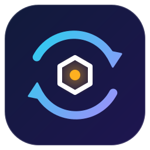
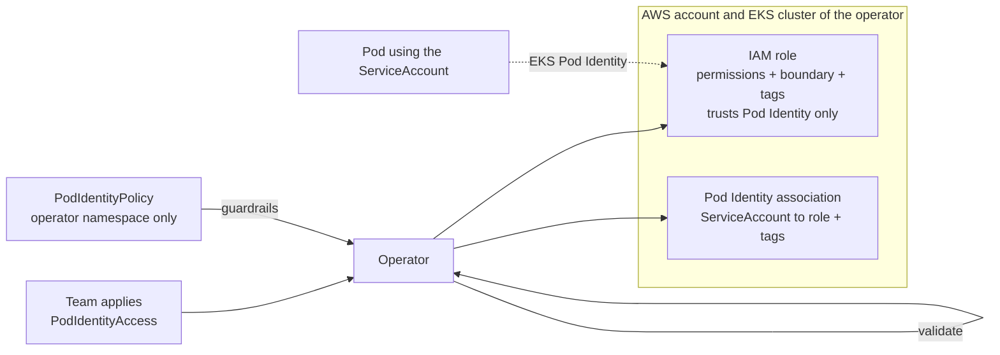

<p align="center">
  
</p>

<h1 align="center">EKS DevOps Operator</h1>

<p align="center"><em>AWS access for Kubernetes workloads from one custom resource.</em></p>

<p align="center">
  <a href="https://github.com/jasonrve/eks-devops-operator/actions/workflows/ci.yml"></a>
  <a href="https://github.com/jasonrve/eks-devops-operator/actions/workflows/codeql.yml"></a>
  <a href="https://jasonrve.github.io/eks-devops-operator/"></a>
  <a href="LICENSE"></a>
  <br>
  
  
  
  
</p>

A Kubernetes operator for Amazon EKS that gives a workload AWS permissions from a single custom resource.
Teams declare what they need. The operator creates the IAM role and the EKS Pod Identity association that deliver the credentials, in the
AWS account and cluster it runs in. Teams never get IAM permissions, and platform admins keep control through guardrails.

Written in C# on .NET 10 with [KubeOps](https://dotnet.github.io/dotnet-operator-sdk/) and the official AWS SDK for .NET.

**[Documentation](https://jasonrve.github.io/eks-devops-operator/)** ·
[Getting started](docs/guide/getting-started.md) ·
[AWS setup](docs/guide/aws-setup.md) ·
[Security model](docs/guide/security.md)

## How it works

```yaml
apiVersion: identity.platform.io/v1alpha1
kind: PodIdentityAccess
metadata:
  name: payments-s3
  namespace: payments
spec:
  serviceAccountName: payments-api
  tags: {App: payments}
  statements:
    - sid: ReadInvoices
      actions: [s3:GetObject, s3:ListBucket]
      resources: [arn:aws:s3:::payments-invoices, arn:aws:s3:::payments-invoices/*]
```



Pods get the role's credentials through the normal AWS SDK credential chain. No application changes.
Resources in other AWS accounts work too: name their ARNs, and let that account's resource policy allow the role.

## Features

- **Pod Identity or IRSA, each its own kind.** `PodIdentityAccess` uses an EKS Pod Identity association; `IrsaAccess` uses an OIDC trust plus the ServiceAccount annotation. See [IRSA](docs/guide/irsa.md).
- **Request access with annotations.** Annotate a ServiceAccount with a policy template and resource ARNs and the operator creates the resource for it, through the same guardrails. See [annotations](docs/guide/annotations.md).
- **One resource, two outcomes.** An IAM role and a Pod Identity association, created in the right order and verified by reading AWS back. `Ready` is never reported on the strength of a create call.
- **Guardrails before AWS.** Allowed services, actions, resource ARN patterns, no wildcards, no privilege-escalation actions. A rejected request changes nothing in AWS.
- **Policies teams cannot touch.** Guardrails are `PodIdentityPolicy` objects that the operator reads only from its own namespace. A look-alike policy in a team namespace is ignored.
- **Tags on everything.** Global tags from the platform team plus per-request tags, on the role and the association. Removed tags are removed; tags added by anyone else are left alone.
- **Strict trust policy.** Only EKS Pod Identity, only this cluster, namespace and ServiceAccount. No account root, no wildcards.
- **Safe by ownership.** Roles and associations are tagged. The operator never modifies or deletes anything it did not create.
- **Self-healing.** Edited trust policies, removed policies and tags, and deleted roles or associations are detected and repaired.
- **Clean lifecycle.** Finalizer-driven cleanup with `Delete` or `Retain`, and safe role renames (the new role is created and the association moved before the old role is removed).
- **Visible.** A Kubernetes event for every create, update, drift repair and delete, structured logs at the right levels with the identifiers to follow one resource, plus status conditions.
- **Operable.** Leader election, backoff with jitter by error type, Prometheus metrics, OpenTelemetry traces, JSON logs, a hardened non-root container.
- **Small image.** About 18 MB compressed (the usual ASP.NET image is about 97 MB): a plain worker host, trimmed, self-contained, distroless, amd64 and arm64. Suggested requests and limits are measured, see [Image and sizing](docs/guide/sizing.md).
- **No database.** Kubernetes holds the desired state and AWS the actual state.

## Quick start (no AWS account)

[Floci](https://github.com/floci-io/floci) emulates AWS and k3s provides Kubernetes. You need Docker and the .NET 10 SDK.

```sh
docker run -d --name floci -p 4566:4566 floci/floci:latest
dotnet test        # engine tests against the emulator
```

To run the operator against a real Kubernetes API and watch a resource go `Ready`, follow
**[Getting started](docs/guide/getting-started.md)**. It takes about five minutes.

## Install on EKS

Prerequisites: an EKS cluster with the Pod Identity Agent add-on, and the IAM role and boundary from **[AWS setup](docs/guide/aws-setup.md)**.

```sh
helm install pio oci://ghcr.io/jasonrve/charts/eks-devops-operator --version 0.1.0 \
  -n pio --create-namespace --set cluster.name=my-eks -f my-values.yaml
```

```yaml
# my-values.yaml
environment: prod
tags:                 # added to every role and association
  CostCenter: cc-1234
policy:               # becomes a PodIdentityPolicy in the operator namespace
  allowedServices: [s3]
  allowedActions: [s3:GetObject, s3:ListBucket]
  allowedResourceArnPatterns: ["arn:aws:s3:::payments-*"]
```

See [Installing with Helm](docs/guide/installation.md), [configuration](docs/guide/configuration.md) and [Helm values](docs/reference/helm-values.md).

## Security at a glance

| Concern | Control |
|---|---|
| Operator credentials | EKS Pod Identity. No static AWS keys. |
| Team privilege escalation | Deny by default, allow-lists for services, actions and resources, no wildcards or IAM/STS actions, permissions boundary on every role. Policies are read only from the operator namespace. |
| Taking over other roles | Ownership tag + path check before any change |
| Trust | The role trusts only Pod Identity for this cluster, namespace and ServiceAccount |
| Tags | Global tags cannot be overridden; `pio:` and `aws:` keys are reserved |
| Secrets | None stored. Credentials, tokens and keys are redacted from logs, status and events |
| Runtime | Non-root, read-only filesystem, capabilities dropped, seccomp RuntimeDefault |

Read the full [security model](docs/guide/security.md), including residual risks. Report vulnerabilities as described in [SECURITY.md](SECURITY.md).

## Repository layout

```text
src/EksDevopsOperator/   Engine/ (validate, plan, reconcile)  Aws/ (SDK calls)  Kube/ (CRDs, controller)
tests/                      unit tests + engine tests against Floci
deploy/helm/                Helm chart (the CRDs live in crds/)
docs/                       VitePress documentation site
examples/                   ready-to-apply resources
local/                      Floci seeding script for local runs
.github/workflows/          CI, CodeQL, docs, release
```

## Status and limitations

- API version `v1alpha1`: breaking changes are possible between releases.
- Credential delivery into a pod is **not** covered by the automated tests, because the emulator does not enforce IAM trust or inject pod credentials. Validate in a real EKS cluster before relying on it.
- The emulator cannot tag Pod Identity associations in place, so there a tag change recreates the association. AWS tags it in place.
- The API is deliberately small: one resource, one role per ServiceAccount, in the operator's own account and cluster.

## Contributing

Build with `dotnet build`, test with `dotnet test` (with Floci running), and see [Development](docs/guide/development.md).
Run `npm run dev` in `docs/` to preview the documentation.

## License

MIT, see [LICENSE](LICENSE).
