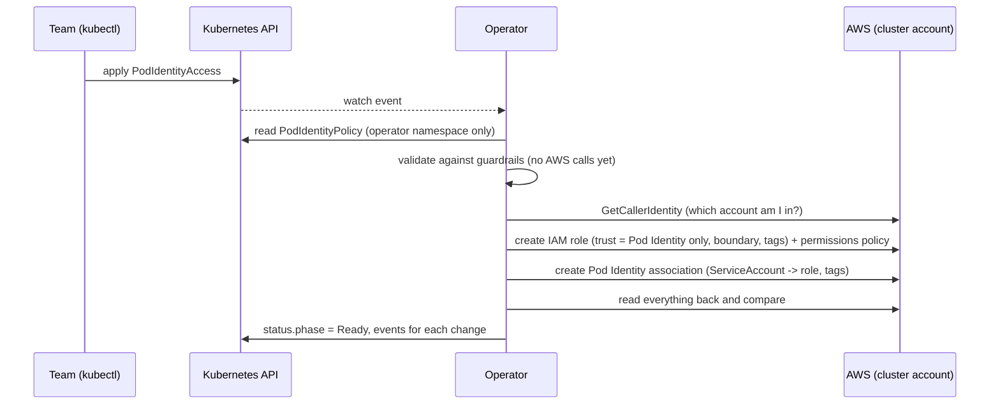

# How it works

## One role, one binding

The role is bound to the ServiceAccount in one of two ways, and each has its own kind: **`PodIdentityAccess`** uses an EKS Pod Identity association (described below), **`IrsaAccess`** uses IRSA (see [IRSA](/guide/irsa)). Both go through the same guardrails and engine. A ServiceAccount can also ask for either one with [annotations](/guide/annotations).
(the role trusts the cluster's OIDC provider and the ServiceAccount gets an annotation). Everything else is identical. See [IRSA](/guide/irsa).

## One role, one association

EKS Pod Identity connects a Kubernetes ServiceAccount to an IAM role: pods that use the ServiceAccount receive that role's temporary credentials.
The operator creates both halves and keeps them in sync. Everything is in the AWS account and the EKS cluster the operator itself runs in.

## What gets created

For one `PodIdentityAccess` the operator owns two AWS objects:

1. **IAM role**, path `/eks-devops-operator/`.
   - **Trust policy:** `pods.eks.amazonaws.com` with `sts:AssumeRole` and `sts:TagSession`, limited to this account and cluster. Session tags stay on, and the trust requires
     the namespace, ServiceAccount and cluster name carried in those tags (`aws:RequestTag/kubernetes-namespace` and so on). Teams cannot supply or change it.
   - **Permissions:** the statements from your resource as an inline policy `pio-permissions`, plus any approved managed policies.
   - **Permissions boundary** when the policies require one, **tags** (below), and ownership tags.
2. **Association** in the cluster: `namespace/serviceAccount → role`, with the same tags.

Role names are deterministic, `pio-<cluster>-<namespace>-<serviceaccount>-<hash>`. The hash covers the full identity, so truncation can never collide.

## Tags

Every role and association gets three groups of tags:

| Group | Source | Example |
|---|---|---|
| Ownership | The operator | `pio:operator`, `pio:cluster`, `pio:namespace`, `pio:service-account`, `pio:uid`, `pio:environment` |
| Global | Helm value `tags` (platform admins) | `CostCenter: cc-1234` |
| Per request | `spec.tags` | `App: payments` |

A request cannot override a global tag; it is rejected with `TagConflict`. The operator records the custom keys it applied in the tag `pio:managed-tag-keys`.
When you remove a tag from the request, or the platform team removes a global tag, the operator removes exactly the keys it applied before.
**Tags someone else added to the role in AWS (for example by an AWS Config rule) are never removed.**

## Reconcile loop

Every pass is level-based and safe to repeat:

1. **Validate.** Namespace policy, services, actions, resources, role name, tags. An invalid request never touches AWS.
2. **Check ownership claims** for the ServiceAccount. If two resources claim it, the oldest wins and the other reports `Conflict`.
3. **Observe** the real AWS state (read-only) and refuse to touch any role or association the operator does not own.
4. **Plan** the smallest set of steps (role, then policy, then association; an obsolete role last).
5. **Record intent** in `status`, so a crash after an AWS write can still find and clean up the role.
6. **Execute**, then **verify** by reading back until AWS matches (bounded wait for IAM's eventual consistency).

Ready resources are re-checked every `driftInterval` (default 10 minutes).

## Changing and deleting

| Change | Behaviour |
|---|---|
| Edit the statements | The inline policy is updated in place. Same role. |
| Edit the tags | Tags are updated on the role and the association; removed keys are removed. |
| Change `roleName` | A new role is created, the association is moved, then the old role is deleted (only if the operator owns it). |
| Delete the resource, `Delete` | Association and role are removed. |
| Delete the resource, `Retain` | Only the association is removed. The role stays, still tagged, and an event lists what remains. |

## Error handling

Errors are classified: **transient** (throttling, timeouts, eventual consistency) retries with exponential backoff and jitter,
**authorization** (access denied) backs off for minutes, **permanent** (invalid request, role owned by someone else) backs off for many minutes.
A bad request never retries in a tight loop.
